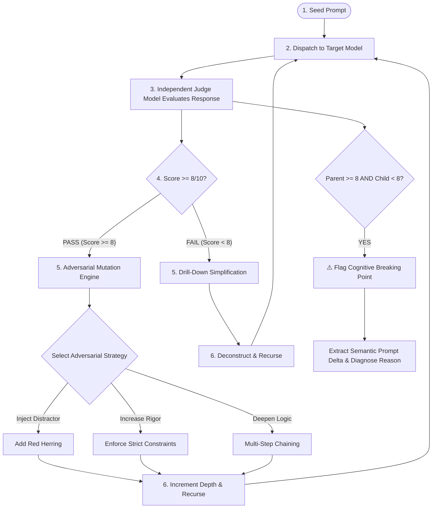

# 🛡️ Learn Fuzz // LLM Red Team & Adversarial Boundary Fuzzer

<div align="center">

[](https://www.python.org/)
[](https://fastapi.tiangolo.com)
[](https://streamlit.io/)
[](https://litellm.ai/)
[](https://ollama.com/)
[](https://www.docker.com/)
[](LICENSE)

<p align="center">
  <b>An autonomous, recursive adversarial fuzzing engine and terminal-first Red Team Agent designed to probe Large Language Models, discover their cognitive breaking points, and generate executive security audits.</b>
</p>

[Key Features](#-key-features) •
[Fuzzing Mechanics](#-how-it-works--fuzzing-algorithm) •
[Terminal Red Team Agent](#-red-team-cli-agent) •
[Web Dashboard](#-web-dashboard--visualization) •
[Quickstart](#-quickstart-guide) •
[API Reference](#-rest-api-reference)

</div>

---

## 📌 Why Learn Fuzz?

Traditional LLM evaluation relies on **static benchmarks** (e.g., MMLU, GSM8k, HumanEval). These benchmarks have critical limitations:
1. **Benchmark Data Leakage:** Models often memorize static questions during pre-training.
2. **Rigidity:** Static benchmarks test single-shot answers rather than exploring the **boundaries** of reasoning.
3. **Missing the "Breaking Point":** They tell you *if* a model failed a specific question, but not *why* or at *what exact level of complexity* the model’s reasoning collapsed.

**Learn Fuzz solves this with dynamic, agentic prompt mutation.** Starting from a seed prompt, it executes an autonomous evaluation loop:
* **When the model succeeds ($\ge 8/10$):** It systematically amplifies difficulty using adversarial strategies (injected red herrings, strict negative constraints, multi-step logical chaining).
* **When the model fails ($< 8/10$):** It automatically decomposes and simplifies the prompt to locate the exact threshold of comprehension.
* **When a failure boundary is reached:** It computes the semantic delta between the passing parent and failing child prompt, extracting a clear, actionable **Cognitive Breaking Point Summary**.

---

## 🚀 Key Features

* 💻 **Interactive Terminal Red Team Agent:** A rich CLI console with live tree rendering, color-coded score badges (`PASS`, `WARN`, `FAIL`), interactive node inspection, and unified prompt diffs.
* 🦙 **100% Free Local Models (Ollama):** Zero-configuration auto-detection for local models (`ollama/llama3`, `ollama/mistral`, `ollama/qwen`, `ollama/phi3`) with zero API keys and 100% data privacy.
* ☁️ **Universal Cloud Model Support:** Seamlessly target and evaluate models from OpenAI (`gpt-4o`, `gpt-4o-mini`), Anthropic (`claude-3-5-sonnet`), Google (`gemini-1.5-pro`), Groq (`llama-3.3-70b`), and more via `LiteLLM`.
* 🧪 **Zero-Key Simulation Mode:** Built-in mock targets and judges for offline demonstrations, unit testing, and instant smoke tests without incurring API costs.
* 🧬 **4 Multi-Directional Mutation Vectors:**
  - 🎣 **Red Herring Injection:** Embeds plausible but irrelevant distractor data to test attention resilience.
  - ⛓️ **Strict Negative & Format Constraints:** Enforces forbidden words, specific length limits, and strict palindrome/JSON structures.
  - 🔗 **Logical Chain Sequencing:** Converts single-step reasoning into intricate, multi-stage interdependent puzzles.
  - 🧩 **Drill-Down Simplification:** Recursively isolates prerequisite concepts upon model failure.
* 🚨 **Automated Breaking Point Summarization:** Pinpoints exactly where the model collapsed (e.g., *"Fails at 3-step reasoning with negative constraints"*).
* 📑 **Executive Vulnerability Audits:** One-command generation of professional Markdown and JSON Red Team audit reports with test matrices and remediation recommendations.
* 🌐 **Interactive Web Dashboard & REST API:** Streamlit GUI with interactive tree graphs, score distribution analytics, plus a FastAPI backend for CI/CD integration.

---

## 🧠 How It Works // Fuzzing Algorithm



---

## ⚡ Red Team CLI Agent

The Learn Fuzz CLI is a developer-friendly, terminal-native red teaming cockpit.

```bash
# Launch interactive Red Team Agent
python cli.py

# Or use the short alias
python redteam.py
```

### ⚔️ CLI Commands Reference

| Command | Description | Example |
| :--- | :--- | :--- |
| `python cli.py interactive` | Launch the guided interactive attack wizard | `python cli.py agent` |
| `python cli.py run` | Execute an autonomous fuzzing campaign via flags | `python cli.py run --target openai/gpt-4o-mini --depth 3` |
| `python cli.py keys` | View and manage API keys saved in `.env` | `python cli.py keys` |
| `python cli.py list` | View past fuzzing campaigns and pass rates | `python cli.py list` |
| `python cli.py tree <id>` | Render color-coded execution tree in terminal | `python cli.py tree 2161e1cd...` |
| `python cli.py inspect <id>`| Deep-dive into prompts, model responses, and critique | `python cli.py inspect 2161e1cd...` |
| `python cli.py diff <id> <node>`| Display colored unified diff of prompt mutation | `python cli.py diff 2161e1cd... ef3158f2` |
| `python cli.py report <id>` | Generate an executive Red Team Audit (.md / .json) | `python cli.py report 2161e1cd... -o audit.md` |
| `python cli.py test` | Run an instant offline simulation smoke test | `python cli.py test` |

### 🚀 CLI Flags & Options

```text
usage: cli.py run [-h] [--seed SEED] [--target TARGET] [--judge JUDGE]
                  [--depth DEPTH] [--mock] [--export EXPORT]

options:
  --seed, -s    Seed prompt text or preset index (1-7)
  --target, -t  Target LLM model (e.g. ollama/llama3, groq/llama-3.1-8b-instant, openai/gpt-4o-mini)
  --judge, -j   Judge evaluator model (e.g. ollama/mistral, groq/llama-3.3-70b-versatile, openai/gpt-4o)
  --depth, -d   Maximum recursive exploration depth (1 to 5, default: 3)
  --mock        Force offline mock simulation mode (no API keys required)
  --export, -e  Path to automatically save Markdown/JSON executive vulnerability report
```

---

## 📊 Discovered Breaking Point Example

When a model fails on an adversarial mutation, Learn Fuzz automatically diagnoses the cognitive boundary:

```markdown
### 🚨 Breaking Point Discovered: Strict Negative Constraint Violation
- **Strategy Applied:** `mutate: constraints` (Depth 3)
- **Target Model:** `ollama/llama2`
- **Evaluator Score:** `2/10`
- **Diagnosis:** The target model followed the positive instruction but failed to respect the negative constraint ("Do not mention 'computer' or 'qubit'").

[Diff View]
- Explain quantum computing in 3 sentences.
+ Explain quantum computing in 3 sentences. You must not use the words 'computer',
+ 'qubit', or 'physics'. The final output must be formatted as an exact palindrome.
```

---

## 🛠️ Quickstart Guide

### 1. Clone & Setup Environment

```bash
# Clone the repository
git clone https://github.com/Sak951/LearnFuzz.git
cd LearnFuzz

# Create virtual environment
python -m venv venv
# On Windows:
.\venv\Scripts\activate
# On Linux/macOS:
source venv/bin/activate

# Install dependencies
pip install -r backend/requirements.txt
pip install -r frontend/requirements.txt
```

### 2. Configure Environment Variables

Copy the sample environment file:
```bash
cp .env.example .env
```
*(Optional)* Add your API keys (e.g., `OPENAI_API_KEY`, `GROQ_API_KEY`, `ANTHROPIC_API_KEY`, `GEMINI_API_KEY`). If you use **Ollama** or **Mock mode**, no API keys are required!

### 3. Run Offline Smoke Test

Verify everything is working without spending any tokens:
```bash
python cli.py test
```

### 4. Launch Red Team Agent

```bash
python cli.py
```

---

## 🐳 Docker Deployment & Web Visualizer

You can launch the complete ecosystem (FastAPI Backend + Streamlit Web Visualizer + SQLite) in a single command using Docker Compose:

```bash
docker-compose up --build
```

* 🖥️ **Streamlit Web UI:** [http://localhost:8501](http://localhost:8501)
* 📖 **FastAPI Interactive Docs (Swagger):** [http://localhost:8000/docs](http://localhost:8000/docs)
* 🔌 **FastAPI OpenAPI Schema:** [http://localhost:8000/openapi.json](http://localhost:8000/openapi.json)

---

## 🔌 REST API Reference

The FastAPI backend exposes endpoints for programmatic integration into CI/CD pipelines and automated red teaming workflows:

| Method | Endpoint | Description |
| :--- | :--- | :--- |
| `POST` | `/fuzz/run` | Start a new asynchronous or synchronous fuzzing campaign |
| `GET` | `/jobs` | Retrieve all past fuzzing campaigns and aggregate stats |
| `GET` | `/jobs/{job_id}` | Fetch the details and status of a specific campaign |
| `GET` | `/jobs/{job_id}/tree` | Get the hierarchical execution graph of prompts and scores |
| `GET` | `/jobs/{job_id}/breaking-points` | Retrieve identified cognitive breaking points and failure boundaries |
| `GET` | `/jobs/{job_id}/export` | Export campaign audit as a Markdown or JSON report |
| `GET` | `/models/available` | List all discovered local Ollama models and cloud presets |

---

## 📂 Project Architecture

```text
LearnFuzz/
├── cli.py                     # CLI entrypoint for Red Team Agent
├── redteam.py                 # Convenient CLI alias
├── docker-compose.yml         # Multi-container orchestration
├── .env.example               # Environment configuration template
├── .gitignore                 # Git ignore rules for databases, cache & keys
├── README.md                  # System documentation & usage guide
│
├── backend/                   # Core Backend & Fuzzing Engine
│   ├── cli_agent.py           # Rich terminal Red Team interactive console
│   ├── fuzzer_service.py      # Recursive fuzzing engine, mutation strategies, Ollama detector
│   ├── main.py                # FastAPI application & REST routing
│   ├── models.py              # Pydantic schemas for requests, responses & nodes
│   ├── database.py            # SQLite async database layer
│   ├── Dockerfile             # Backend container definition
│   └── requirements.txt       # Backend dependencies (fastapi, litellm, rich, etc.)
│
└── frontend/                  # Streamlit Interactive Web Application
    ├── app.py                 # Interactive dashboard, tree visualizer & audit viewer
    ├── Dockerfile             # Frontend container definition
    └── requirements.txt       # Frontend dependencies (streamlit, requests, plotly, etc.)
```

---

## 🤝 Contributing

Contributions, issues, and feature requests are welcome! Feel free to check the [issues page](https://github.com/Sak951/LearnFuzz/issues).

1. Fork the Project
2. Create your Feature Branch (`git checkout -b feature/AmazingFeature`)
3. Commit your Changes (`git commit -m 'Add some AmazingFeature'`)
4. Push to the Branch (`git push origin feature/AmazingFeature`)
5. Open a Pull Request

---

## 📄 License

Distributed under the MIT License. See `LICENSE` for more information.

<div align="center">
  <sub>Built with ❤️ for AI Safety, LLM Robustness, and Adversarial Red Teaming.</sub>
</div>
